# Mud Pie Masters — original asset and visual provenance gallery

**Verified source tree:** `main` commit [`d2828e4`](https://github.com/importedcadaver-dotcom/random-mash-of-vibecoded-slop/commit/d2828e4f1fcdbbd3a3c3ed7cd5675bc8de1a4f4d), November 11, 2026 (Pacific)  
**Scope:** 17 original tracked PNG assets, five tracked WAV files, nine historical art previews, and a pointer to the current Windows-hosted Pygame screenshots.  
**Status:** Preservation and inspection index, **not** an art approval or proof of physical Windows usability.

This page embeds **existing tracked PNGs** by relative path; images are not regenerated or changed. Click any thumbnail to inspect the unmodified original image. The tracked judge PNGs are legacy source assets and should **not** be assumed to match the judge portraits currently generated by `mudpie/rendering.py`.

## 1. Current original cubs and expression sprites

The game contains three main cub identities. Their four tracked expression PNGs each share the same project pixel-art lineage. Source: `assets/` and `tools/generate_cute_cubs.py`.

| Character | Idle | Blink | Cheer | Sad |
|---|---|---|---|---|
| **Player cub** | <a href="../assets/player.png">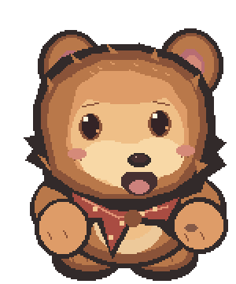</a> |  |  | <a href="../assets/player_sad.png">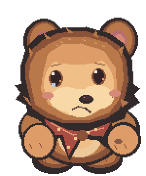</a> |
| **Bruno** | <a href="../assets/bruno.png">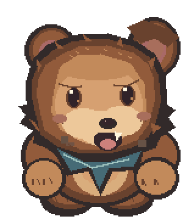</a> | <a href="../assets/bruno_blink.png">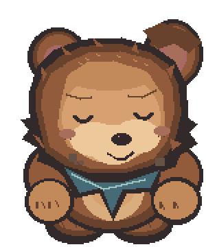</a> | <a href="../assets/bruno_cheer.png">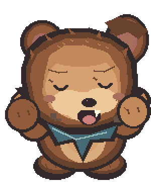</a> | <a href="../assets/bruno_sad.png">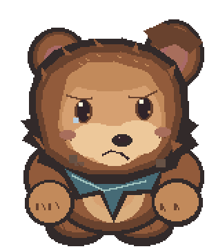</a> |
| **Daisy** | <a href="../assets/daisy.png">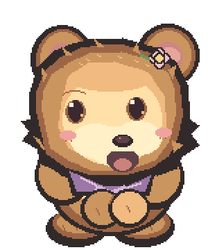</a> | <a href="../assets/daisy_blink.png">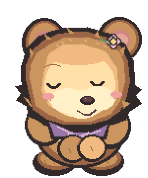</a> | <a href="../assets/daisy_cheer.png">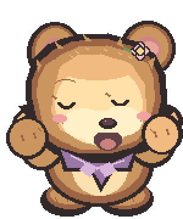</a> | <a href="../assets/daisy_sad.png">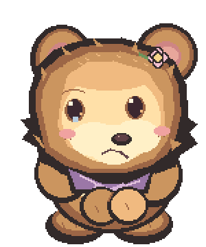</a> |

**Creative authority:** Existing sprites remain valued placeholders; later comparative feedback identifies **Bruno** as the strongest individual visual benchmark, not Daisy. That does not revoke earlier positive feedback about Daisy's personality and artwork. Original E1/E2 sprite experiments were rejected; no E3 replacement or new judge portrait has been approved. See [archaeology source-of-truth index](ARCHAEOLOGY_INDEX.md) for chronological attribution.

## 2. Legacy judge source PNGs versus actual runtime judges

| Original tracked source | Original tracked source | Original tracked source |
|---|---|---|
| <a href="../assets/petal.png">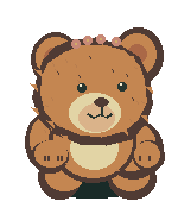</a>
<strong>Petal</strong>
 | <a href="../assets/boulder.png">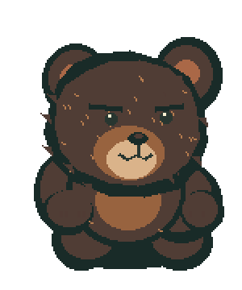</a>
<strong>Boulder</strong>
 | <a href="../assets/fern.png">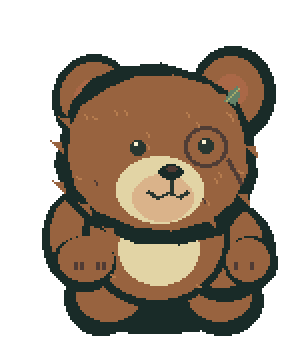</a>
<strong>Fern</strong>
 |

**Provenance caveat:** Following PR #14, the game constructs its current judge appearances at runtime in `mudpie/rendering.py` from cub-style artwork. These three PNGs are preserved **fallback/legacy sources** and cannot establish what the current judge screens look like. Use the real runtime judging screenshots referenced below to evaluate the active portrayal. The user's earlier teddy-bear judge objection still requires updated human art feedback.

## 3. Original backgrounds

| Woodland scene | Crafting table |
|---|---|
| <a href="../assets/forest.png">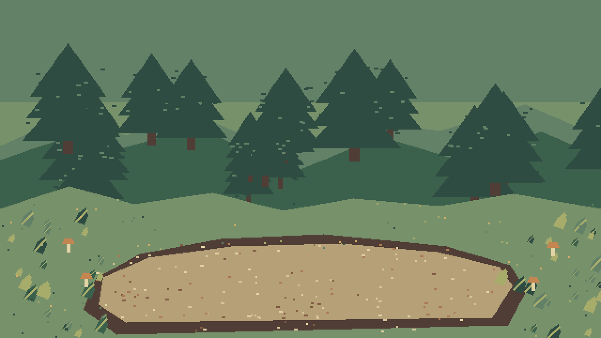</a> | <a href="../assets/table.png">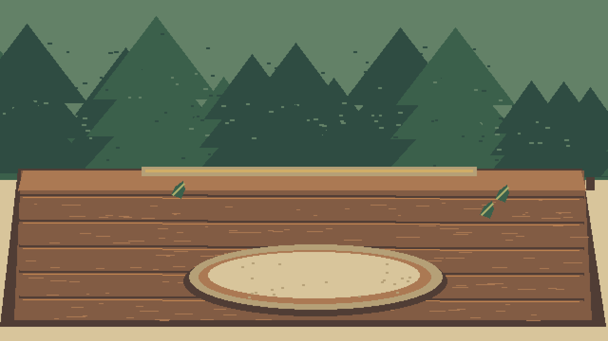</a> |

These are in the actual `assets/` tree, unlike the **composite previews** in the next section.

## 4. Historical previews — not automatically game screenshots

The nine PNGs below are prebuilt visual compositions / art comparison images in `docs/`. **Do not describe them as captures from Pygame execution without specific evidence.** They remain useful for art-direction history and comparison.

| Preview | Original tracked file |
|---|---|
| <a href="v04_cub_reveal.png">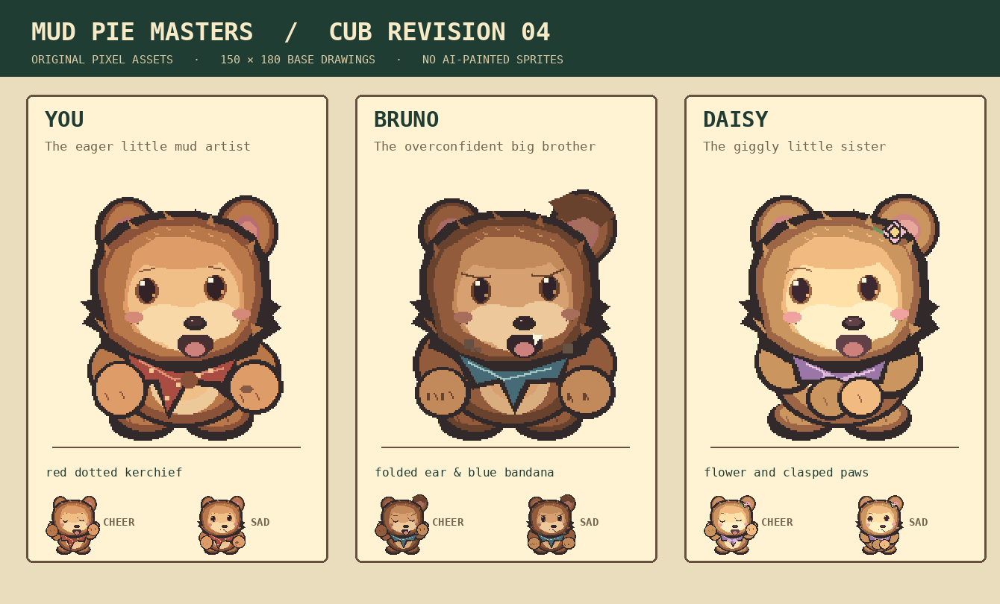</a> | [v04_cub_reveal.png](v04_cub_reveal.png) |
| <a href="v04_expressions_contact.png">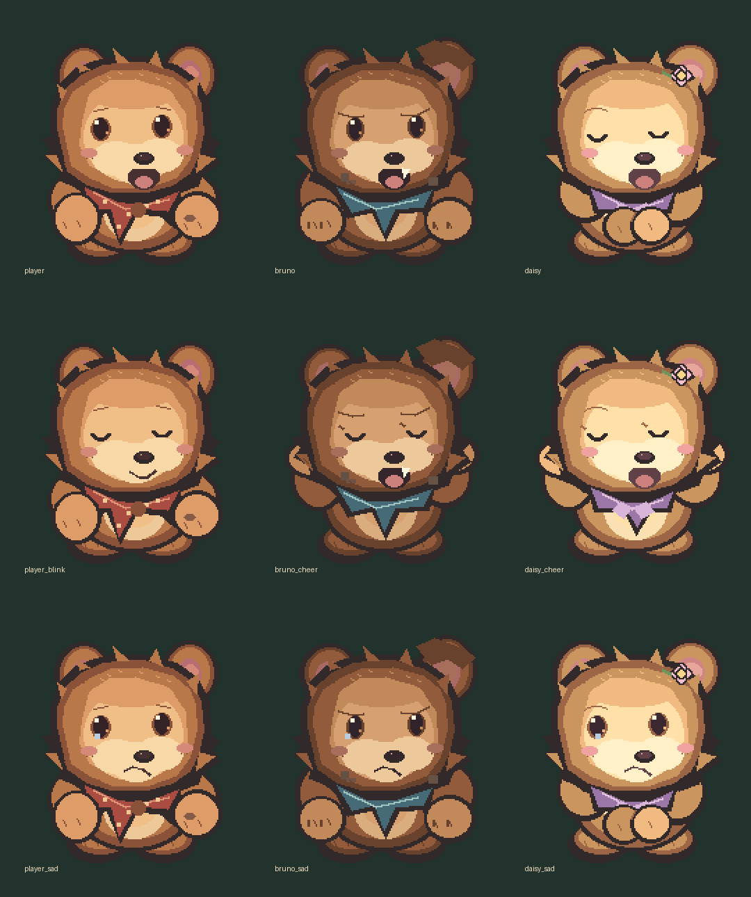</a> | [v04_expressions_contact.png](v04_expressions_contact.png) |
| <a href="v04_before_after.png">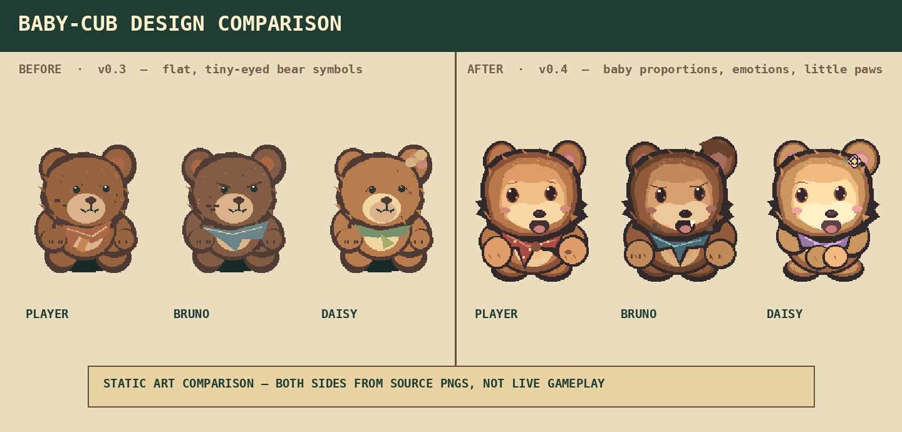</a> | [v04_before_after.png](v04_before_after.png) |
| <a href="before_after_art.png">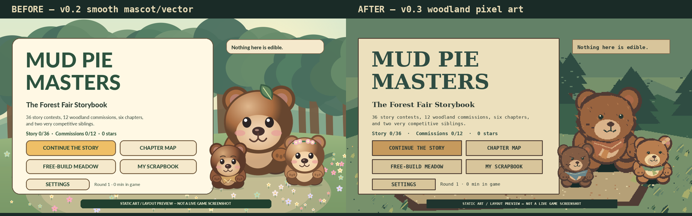</a> | [before_after_art.png](before_after_art.png) |
| <a href="new_character_roster.png">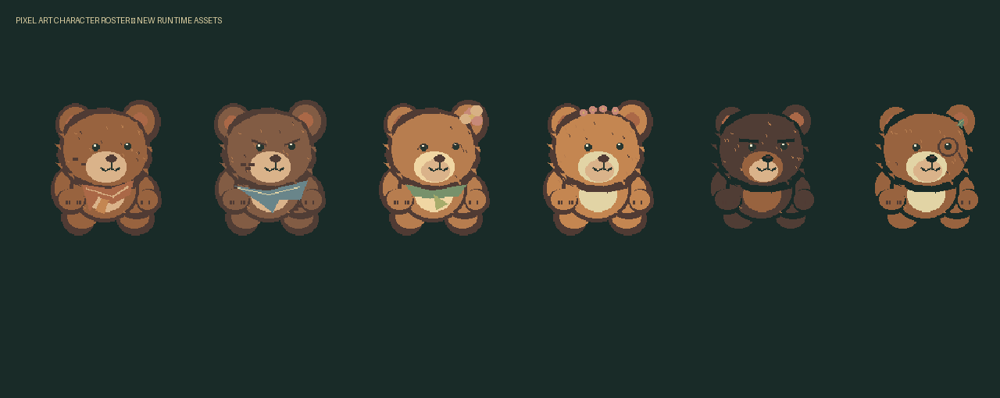</a> | [new_character_roster.png](new_character_roster.png) |
| <a href="title_art_preview.png">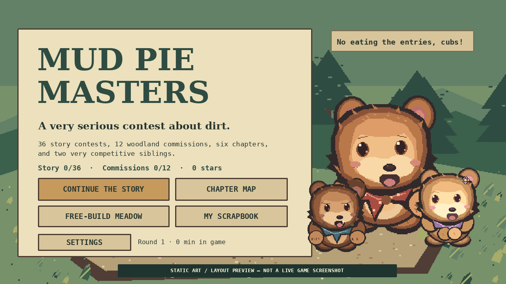</a> | [title_art_preview.png](title_art_preview.png) |
| <a href="craft_layout_preview.png">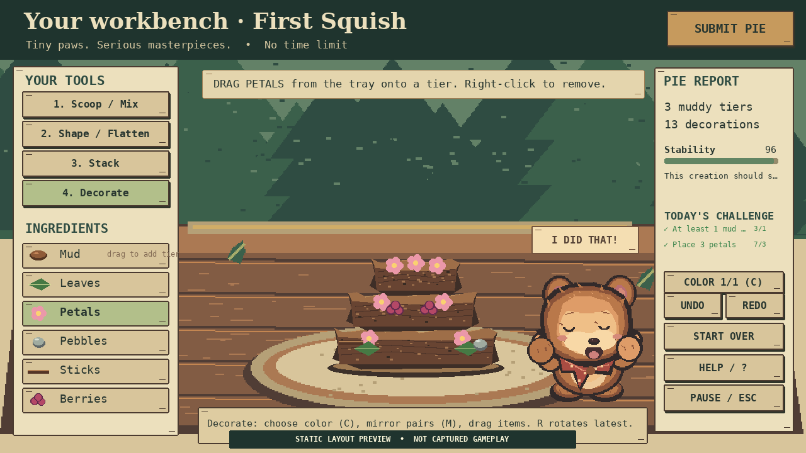</a> | [craft_layout_preview.png](craft_layout_preview.png) |
| <a href="campaign_layout_preview.png">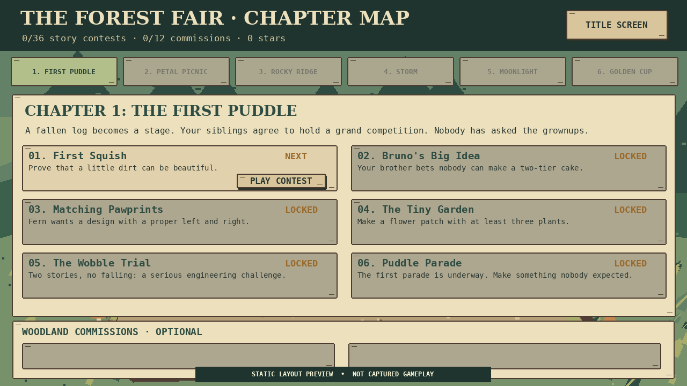</a> | [campaign_layout_preview.png](campaign_layout_preview.png) |
| <a href="results_layout_preview.png">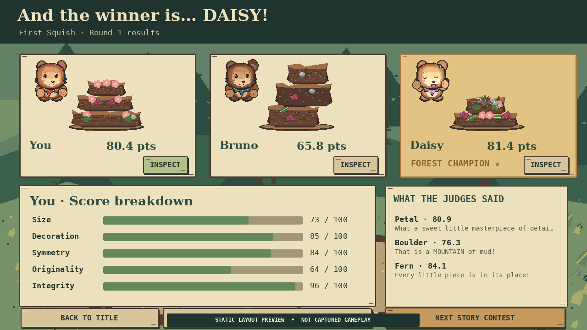</a> | [results_layout_preview.png](results_layout_preview.png) |

## 5. Original audio files

| File | Role in game | Provenance |
|---|---|---|
| [squish.wav](../assets/squish.wav) | Squish sound | Original tracked game asset |
| [splat.wav](../assets/splat.wav) | Mud impact sound | Original tracked game asset |
| [pop.wav](../assets/pop.wav) | UI/interaction sound | Original tracked game asset |
| [fanfare.wav](../assets/fanfare.wav) | Celebration fanfare | Original tracked game asset |
| [music.wav](../assets/music.wav) | Background music | Original tracked game asset |

File presence does **not** establish successful sound playback on a physical Windows machine.

## 6. Current real runtime-rendered evidence

[**Windows/Linux Pygame screenshot workflow**](https://github.com/importedcadaver-dotcom/random-mash-of-vibecoded-slop/actions/runs/43133410394): the successful Windows job uploaded artifact `mudpie-runtime-windows-latest` (artifact ID **13905668237**), containing **26 genuine Pygame frames** with SDL-dummy video, including tutorial, palette, falling mud, presentation, judges, results, title and resized layouts. The same run includes Linux runtime captures and full-campaign oracle artifacts.

[**Windows EXE build/smoke run**](https://github.com/importedcadaver-dotcom/random-mash-of-vibecoded-slop/actions/runs/43133410374): the successful job uploaded `MudPieMasters-Windows-PreRelease` (artifact ID **13906002610**). It launched using dummy SDL, not a physical monitor/input/audio test.

An independently assembled **26-frame Windows-hosted contact-sheet + ZIP atlas** was made in the archaeology conversation from those unchanged run artifacts. Those conversation artifacts are **not part of this repository**. If they are no longer accessible, retrieve the source artifact from the linked GitHub Actions run instead.

## 7. Preservation and open gates

- Never replace original PNGs or present art experiments as approved without a substantive creative review.
- Judge aesthetics, sprite scaling, typography and physical screen layout are still **human evaluation targets**, not covered by successful file existence checks.
- Preserve `gameplay_hours_verified=false`: no independent 120-active-minute human fun playtest or comprehensive physical Windows mouse/audio assessment is documented.
- The canonical work tracker is [Issue #18 — archaeology](https://github.com/importedcadaver-dotcom/random-mash-of-vibecoded-slop/issues/18); the historical user-playtest intake is [Issue #9](https://github.com/importedcadaver-dotcom/random-mash-of-vibecoded-slop/issues/9) and the release gate is [Issue #2](https://github.com/importedcadaver-dotcom/random-mash-of-vibecoded-slop/issues/2).

**This index inventories every currently tracked PNG and WAV under the game's `assets/` directory at the cited source tree; it does not claim to have located every historical asset across inaccessible conversations, old releases or external drives.**
